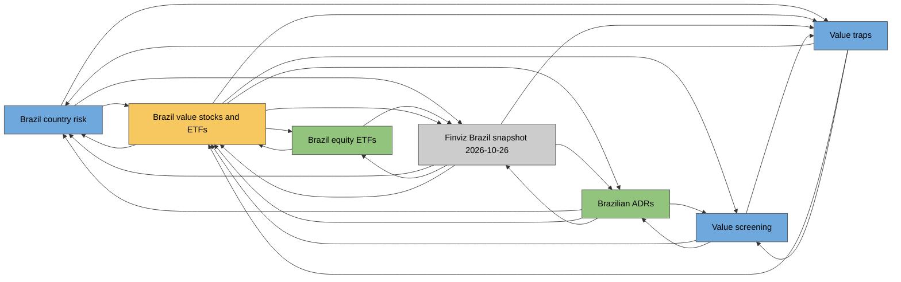

# Graph

Generated by `wiki.py graph` on 2026-10-27. Do not edit by hand.
How the pages connect; `wiki/overview.md` is left out because it links to
everything. In Obsidian, Graph view shows the same links interactively.

7 page(s), 26 link(s), 1 idea(s).

## Map

Colours: ideas yellow, concepts blue, entities green, questions purple,
sources grey. Thick arrows join two ideas.

## Ideas (1)

| Idea | Stage | Verdict | Confidence | Sources | Evidence links | Hypotheses | Falsification test | Latest verdict |
|---|---|---|---|---|---|---|---|---|
| [[brazil-value-stocks-and-etfs]] | research | none yet | low | 0 | 1 | 9 | yes | 2026-10-26: entered, no verdict yet |

## How ideas relate

(no two ideas connect yet)

## Hubs (most connected)

- [[brazil-value-stocks-and-etfs]] (idea): 6 link(s)
- [[finviz-brazil-snapshot-2026-10-26]] (source): 5 link(s)
- [[brazil-country-risk]] (concept): 4 link(s)
- [[brazilian-adrs]] (entity): 4 link(s)
- [[value-traps]] (concept): 4 link(s)
- [[value-screening]] (concept): 3 link(s)
- [[brazil-equity-etfs]] (entity): 2 link(s)

## Clusters

- cluster 1 (7 pages): [[brazil-value-stocks-and-etfs]], [[finviz-brazil-snapshot-2026-10-26]], [[brazil-country-risk]], [[brazilian-adrs]], [[value-traps]], [[value-screening]], [[brazil-equity-etfs]]

## Suggested links

Pages not linked to each other that share two or more neighbours.

- [[brazilian-adrs]] and [[value-traps]] share [[brazil-country-risk]], [[brazil-value-stocks-and-etfs]], [[finviz-brazil-snapshot-2026-10-26]], [[value-screening]]
- [[brazil-country-risk]] and [[value-screening]] share [[brazil-value-stocks-and-etfs]], [[brazilian-adrs]], [[value-traps]]
- [[finviz-brazil-snapshot-2026-10-26]] and [[value-screening]] share [[brazil-value-stocks-and-etfs]], [[brazilian-adrs]], [[value-traps]]
- [[brazil-country-risk]] and [[brazil-equity-etfs]] share [[brazil-value-stocks-and-etfs]], [[finviz-brazil-snapshot-2026-10-26]]
- [[brazil-equity-etfs]] and [[brazilian-adrs]] share [[brazil-value-stocks-and-etfs]], [[finviz-brazil-snapshot-2026-10-26]]
- [[brazil-equity-etfs]] and [[value-traps]] share [[brazil-value-stocks-and-etfs]], [[finviz-brazil-snapshot-2026-10-26]]

## Unlinked mentions

A page names another page's title without linking it.

(none)
