# Graph

Generated by `wiki.py graph` on 2026-10-27. Do not edit by hand.
How the pages connect; `wiki/overview.md` is left out because it links to
everything. In Obsidian, Graph view shows the same links interactively.

13 page(s), 56 link(s), 2 idea(s).

## Map

Colours: ideas yellow, concepts blue, entities green, questions purple,
sources grey. Thick arrows join two ideas.

```mermaid
graph LR
  classDef idea fill:#f6c85f,stroke:#555,color:#000
  classDef concept fill:#6fa8dc,stroke:#555,color:#000
  classDef entity fill:#93c47d,stroke:#555,color:#000
  classDef question fill:#c27ba0,stroke:#555,color:#000
  classDef source fill:#cccccc,stroke:#555,color:#000
  n_brazil_country_risk["Brazil country risk"]:::concept
  n_brazil_equity_etfs["Brazil equity ETFs"]:::entity
  n_brazil_value_stocks_and_etfs["Brazil value stocks and ETFs"]:::idea
  n_brazilian_adrs["Brazilian ADRs"]:::entity
  n_china_bank_stocks["Which Chinese bank stocks can Wei buy and how cheap are they"]:::question
  n_china_country_risk["China country risk"]:::concept
  n_china_equity_etfs["China equity ETFs"]:::entity
  n_china_value_stocks_and_etfs["China value stocks and ETFs"]:::idea
  n_chinese_adrs["Chinese ADRs"]:::entity
  n_finviz_brazil_snapshot_2026_10_26["Finviz Brazil snapshot 2026-10-26"]:::source
  n_finviz_china_snapshot_2026_10_26["Finviz China snapshot 2026-10-26"]:::source
  n_value_screening["Value screening"]:::concept
  n_value_traps["Value traps"]:::concept
  n_brazil_country_risk --> n_brazil_value_stocks_and_etfs
  n_brazil_country_risk --> n_finviz_brazil_snapshot_2026_10_26
  n_brazil_country_risk --> n_value_traps
  n_brazil_equity_etfs --> n_brazil_value_stocks_and_etfs
  n_brazil_equity_etfs --> n_finviz_brazil_snapshot_2026_10_26
  n_brazil_value_stocks_and_etfs --> n_brazil_country_risk
  n_brazil_value_stocks_and_etfs --> n_brazil_equity_etfs
  n_brazil_value_stocks_and_etfs --> n_brazilian_adrs
  n_brazil_value_stocks_and_etfs ==> n_china_value_stocks_and_etfs
  n_brazil_value_stocks_and_etfs --> n_finviz_brazil_snapshot_2026_10_26
  n_brazil_value_stocks_and_etfs --> n_value_screening
  n_brazil_value_stocks_and_etfs --> n_value_traps
  n_brazilian_adrs --> n_brazil_country_risk
  n_brazilian_adrs --> n_brazil_value_stocks_and_etfs
  n_brazilian_adrs --> n_finviz_brazil_snapshot_2026_10_26
  n_brazilian_adrs --> n_value_screening
  n_china_bank_stocks --> n_china_country_risk
  n_china_bank_stocks --> n_china_equity_etfs
  n_china_bank_stocks --> n_china_value_stocks_and_etfs
  n_china_bank_stocks --> n_value_screening
  n_china_bank_stocks --> n_value_traps
  n_china_country_risk --> n_brazil_country_risk
  n_china_country_risk --> n_china_value_stocks_and_etfs
  n_china_country_risk --> n_finviz_china_snapshot_2026_10_26
  n_china_country_risk --> n_value_traps
  n_china_equity_etfs --> n_brazil_equity_etfs
  n_china_equity_etfs --> n_china_value_stocks_and_etfs
  n_china_equity_etfs --> n_finviz_china_snapshot_2026_10_26
  n_china_value_stocks_and_etfs ==> n_brazil_value_stocks_and_etfs
  n_china_value_stocks_and_etfs --> n_china_bank_stocks
  n_china_value_stocks_and_etfs --> n_china_country_risk
  n_china_value_stocks_and_etfs --> n_china_equity_etfs
  n_china_value_stocks_and_etfs --> n_chinese_adrs
  n_china_value_stocks_and_etfs --> n_finviz_china_snapshot_2026_10_26
  n_china_value_stocks_and_etfs --> n_value_screening
  n_china_value_stocks_and_etfs --> n_value_traps
  n_chinese_adrs --> n_brazilian_adrs
  n_chinese_adrs --> n_china_bank_stocks
  n_chinese_adrs --> n_china_country_risk
  n_chinese_adrs --> n_china_value_stocks_and_etfs
  n_chinese_adrs --> n_finviz_china_snapshot_2026_10_26
  n_finviz_brazil_snapshot_2026_10_26 --> n_brazil_country_risk
  n_finviz_brazil_snapshot_2026_10_26 --> n_brazil_equity_etfs
  n_finviz_brazil_snapshot_2026_10_26 --> n_brazil_value_stocks_and_etfs
  n_finviz_brazil_snapshot_2026_10_26 --> n_brazilian_adrs
  n_finviz_brazil_snapshot_2026_10_26 --> n_value_traps
  n_finviz_china_snapshot_2026_10_26 --> n_china_equity_etfs
  n_finviz_china_snapshot_2026_10_26 --> n_china_value_stocks_and_etfs
  n_finviz_china_snapshot_2026_10_26 --> n_chinese_adrs
  n_finviz_china_snapshot_2026_10_26 --> n_value_traps
  n_value_screening --> n_brazil_value_stocks_and_etfs
  n_value_screening --> n_brazilian_adrs
  n_value_screening --> n_value_traps
  n_value_traps --> n_brazil_country_risk
  n_value_traps --> n_brazil_value_stocks_and_etfs
  n_value_traps --> n_value_screening
```

## Ideas (2)

| Idea | Stage | Verdict | Confidence | Sources | Evidence links | Hypotheses | Falsification test | Latest verdict |
|---|---|---|---|---|---|---|---|---|
| [[brazil-value-stocks-and-etfs]] | research | none yet | low | 0 | 1 | 9 | yes | 2026-10-26: entered, no verdict yet |
| [[china-value-stocks-and-etfs]] | research | none yet | low | 0 | 2 | 5 | yes | 2026-10-27: entered, no verdict yet |

## How ideas relate

- [[brazil-value-stocks-and-etfs]] and [[china-value-stocks-and-etfs]]: [[brazil-value-stocks-and-etfs]] links to [[china-value-stocks-and-etfs]] under "Related ideas"; [[china-value-stocks-and-etfs]] links to [[brazil-value-stocks-and-etfs]] under "Wei's constraints"; share [[value-screening]], [[value-traps]]

## Hubs (most connected)

- [[china-value-stocks-and-etfs]] (idea): 8 link(s)
- [[value-traps]] (concept): 8 link(s)
- [[brazil-value-stocks-and-etfs]] (idea): 7 link(s)
- [[china-bank-stocks]] (question): 6 link(s)
- [[china-country-risk]] (concept): 6 link(s)
- [[brazil-country-risk]] (concept): 5 link(s)
- [[brazilian-adrs]] (entity): 5 link(s)
- [[chinese-adrs]] (entity): 5 link(s)
- [[finviz-brazil-snapshot-2026-10-26]] (source): 5 link(s)
- [[finviz-china-snapshot-2026-10-26]] (source): 5 link(s)

## Clusters

- cluster 1 (13 pages): [[china-value-stocks-and-etfs]], [[value-traps]], [[brazil-value-stocks-and-etfs]], [[china-bank-stocks]], [[china-country-risk]], [[brazil-country-risk]], [[brazilian-adrs]], [[chinese-adrs]], [[finviz-brazil-snapshot-2026-10-26]], [[finviz-china-snapshot-2026-10-26]], [[value-screening]], [[china-equity-etfs]] and 1 more

## Suggested links

Pages not linked to each other that share two or more neighbours.

- [[china-bank-stocks]] and [[finviz-china-snapshot-2026-10-26]] share [[china-country-risk]], [[china-equity-etfs]], [[china-value-stocks-and-etfs]], [[chinese-adrs]], [[value-traps]]
- [[brazilian-adrs]] and [[value-traps]] share [[brazil-country-risk]], [[brazil-value-stocks-and-etfs]], [[finviz-brazil-snapshot-2026-10-26]], [[value-screening]]
- [[chinese-adrs]] and [[value-traps]] share [[china-bank-stocks]], [[china-country-risk]], [[china-value-stocks-and-etfs]], [[finviz-china-snapshot-2026-10-26]]
- [[brazil-country-risk]] and [[china-value-stocks-and-etfs]] share [[brazil-value-stocks-and-etfs]], [[china-country-risk]], [[value-traps]]
- [[brazil-country-risk]] and [[value-screening]] share [[brazil-value-stocks-and-etfs]], [[brazilian-adrs]], [[value-traps]]
- [[brazil-value-stocks-and-etfs]] and [[china-bank-stocks]] share [[china-value-stocks-and-etfs]], [[value-screening]], [[value-traps]]
- [[brazil-value-stocks-and-etfs]] and [[china-country-risk]] share [[brazil-country-risk]], [[china-value-stocks-and-etfs]], [[value-traps]]
- [[brazilian-adrs]] and [[china-value-stocks-and-etfs]] share [[brazil-value-stocks-and-etfs]], [[chinese-adrs]], [[value-screening]]
- [[china-country-risk]] and [[china-equity-etfs]] share [[china-bank-stocks]], [[china-value-stocks-and-etfs]], [[finviz-china-snapshot-2026-10-26]]
- [[china-country-risk]] and [[value-screening]] share [[china-bank-stocks]], [[china-value-stocks-and-etfs]], [[value-traps]]
- [[china-equity-etfs]] and [[chinese-adrs]] share [[china-bank-stocks]], [[china-value-stocks-and-etfs]], [[finviz-china-snapshot-2026-10-26]]
- [[china-equity-etfs]] and [[value-traps]] share [[china-bank-stocks]], [[china-value-stocks-and-etfs]], [[finviz-china-snapshot-2026-10-26]]
- [[chinese-adrs]] and [[value-screening]] share [[brazilian-adrs]], [[china-bank-stocks]], [[china-value-stocks-and-etfs]]
- [[finviz-brazil-snapshot-2026-10-26]] and [[value-screening]] share [[brazil-value-stocks-and-etfs]], [[brazilian-adrs]], [[value-traps]]
- [[brazil-country-risk]] and [[brazil-equity-etfs]] share [[brazil-value-stocks-and-etfs]], [[finviz-brazil-snapshot-2026-10-26]]

## Unlinked mentions

A page names another page's title without linking it.

- [[china-country-risk]] mentions "Chinese ADRs" without linking [[chinese-adrs]]
